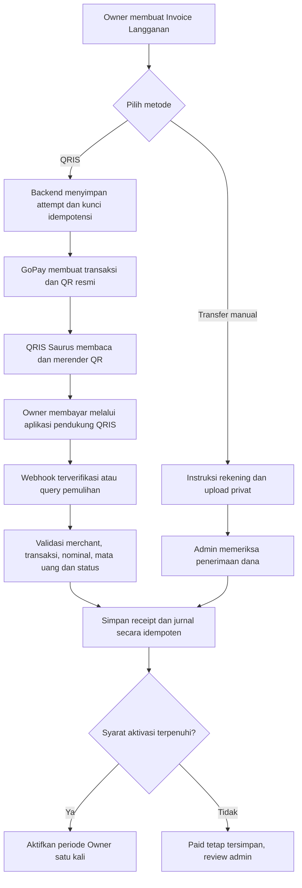

# Rencana migrasi pembayaran langganan: GoPay QRIS dan QRIS Saurus

Tanggal analisis: 14 November 2026. Branch: `codex/qris-saurus`, diturunkan dari `production-v1` pada commit `566c0bc5b1ce7532c5f987e48af03578e616a3fd`.

**Status: layering QR lokal dan UI checkout sudah diimplementasikan; konfirmasi provider otomatis masih berupa rencana.** Keputusan produk Q1–Q8 telah dilanjutkan dengan permintaan pengguna agar QR bernominal langsung dibuat melalui QRIS Saurus dari QR statis yang ada. Akses integrasi resmi GoPay/GoBiz belum tersedia. Bagian alur API provider di bawah adalah target konfirmasi otomatis, bukan gambaran runtime yang sudah aktif. Penyedia harus mengonfirmasi kelayakan akun, kontrak API, dan penerimaan dana ke merchant yang dimaksud sebelum aktivasi otomatis dapat dirilis.

Progres 14 November 2026 pada `codex/fix-admin-cashflow`: QRIS Saurus 1.1.0 terpasang di backend. Endpoint `GET /api/subscription/invoices/:id/qris` membaca gambar QRIS lokal yang dikonfigurasi admin, memvalidasi CRC/merchant/Rupiah, mengisi nominal dari invoice dan merender QR. QR langsung ditampilkan; transfer bank tersedia melalui Ganti metode pembayaran. Konfirmasi masih melalui bukti privat dan verifikasi admin. Endpoint memeriksa ownership/status/expiry dan attempt gateway terbuka, memakai no-store serta throttle per pengguna. Pengaturan baru memvalidasi QR lokal sebelum disimpan dan tidak lagi mengisi fallback gambar ketika konfigurasi kosong. Bukti pengujian dan batas operasional: [QRIS layering readiness](QRIS_LAYERING_READINESS.md).

## 1. Keputusan yang telah dikonfirmasi

Implementasi lanjutan untuk satu invoice aktif per Owner, expiry/cancel, penerimaan manual dan audit terdokumentasi pada [Invoice lifecycle readiness](INVOICE_LIFECYCLE_READINESS.md). Penguncian ini tidak menyediakan pembatalan QR di jaringan acquirer atau konfirmasi dana otomatis.

| Area | Keputusan |
|---|---|
| Tujuan integrasi | Pembayaran langganan SaaS Cleanique, bukan pembayaran cucian pelanggan |
| Penerima | Satu merchant GoPay milik platform, khusus langganan SaaS |
| Status akun | Akun GoPay Merchant tersedia; akses API resmi belum tersedia |
| Otomatisasi | QRIS dengan aktivasi otomatis wajib tersedia sejak rilis pertama pengganti Midtrans |
| Kanal checkout baru | QRIS otomatis dan transfer bank manual dengan verifikasi admin |
| Pembuat QR tagihan saat ini | QRIS Saurus mentransformasi QR statis merchant platform menjadi QR bernominal sesuai permintaan terbaru; tidak membuat transaksi melalui API acquirer |
| Peran QRIS Saurus | Pembacaan, validasi, transformasi lokal, dan render QR di backend; tidak menetapkan uang sudah diterima |
| Persiapan integrasi | Siapkan akses resmi terlebih dahulu; tidak menggunakan API privat atau pembacaan notifikasi HP |
| Midtrans | Belum menerima pembayaran nyata menurut konfirmasi pengguna; histori tetap dipertahankan |
| Infrastruktur | Backend Hono/Bun dan PostgreSQL yang sudah ada pada VPS; tidak menambah server payment terpisah |

Ketentuan produk yang dipertahankan: Premium Rp200.000 per periode bulanan sebelum promo; promo aktif Rp50.000 lalu satu referral valid; invoice menyimpan snapshot harga/Owner/komisi; durasi 1/3/6/12 periode masing-masing 30 hari; invoice berlaku 24 jam; Premium mencakup maksimum lima Cabang termasuk Cabang utama. Contoh satu periode: Rp150.000 setelah promo, atau Rp135.000 jika referral yang berlaku sebesar 10%. Perpanjangan mandiri mengikuti paket yang sama; perubahan paket melalui admin, tanpa proration baru.

## 2. Temuan penelitian dan batas pembuktian

### QRIS Saurus

Audit mengacu ke versi paket 1.1.0 pada commit [`e4b8db524d5e2e89d8e6bd0fa1148170096d720a`](https://github.com/creasico/qris-saurus/tree/e4b8db524d5e2e89d8e6bd0fa1148170096d720a). Library menyediakan pengolahan payload QR serta adapter beberapa gateway; library bukan sumber settlement. [README upstream](https://github.com/creasico/qris-saurus/blob/e4b8db524d5e2e89d8e6bd0fa1148170096d720a/README.md), [package.json](https://github.com/creasico/qris-saurus/blob/e4b8db524d5e2e89d8e6bd0fa1148170096d720a/package.json).

Modul GoPay menandai `supportsApiDynamic: false`; integrasi GoBiz Pay perlu dibuat di Cleanique. Transformasi statis-ke-dinamis hanya mengubah payload; tidak memberi konfirmasi uang atau pembatalan QR di penyedia. CRC memeriksa struktur/integritas QR, bukan keaslian penerimaan pembayaran. [Modul GoPay](https://github.com/creasico/qris-saurus/blob/e4b8db524d5e2e89d8e6bd0fa1148170096d720a/src/providers/gopay.ts), [transformasi lokal](https://github.com/creasico/qris-saurus/blob/e4b8db524d5e2e89d8e6bd0fa1148170096d720a/src/transform/static-to-dynamic.ts), [validator](https://github.com/creasico/qris-saurus/blob/e4b8db524d5e2e89d8e6bd0fa1148170096d720a/src/core/validator.ts).

Contoh Elysia menggunakan penyimpanan proses dan menyediakan simulasi settlement; contoh tersebut tidak menjadi fondasi deployment produksi. Poller SDK juga tidak menggantikan antrean/recovery persisten. Reuse dibatasi pada fungsi QR yang lolos audit dan pengujian kontrak. [Contoh route](https://github.com/creasico/qris-saurus/blob/e4b8db524d5e2e89d8e6bd0fa1148170096d720a/examples/elysiajs/src/routes/payments.ts), [penyimpanan contoh](https://github.com/creasico/qris-saurus/blob/e4b8db524d5e2e89d8e6bd0fa1148170096d720a/examples/elysiajs/src/lib/payments.ts), [poller SDK](https://github.com/creasico/qris-saurus/blob/e4b8db524d5e2e89d8e6bd0fa1148170096d720a/src/providers/adapters/poller.ts).

### GoPay/GoBiz resmi

Dokumentasi menyediakan OAuth direct integration, dengan izin bergantung produk. Panduan Developer Portal yang tersedia berfokus pada GoFood; kepemilikan akun merchant belum membuktikan akses Pay/QRIS. Kelayakan akun Cleanique dan produk yang dapat diaktifkan harus dikonfirmasi oleh penyedia. [Panduan resmi](https://app.gobiz.com/files/static/cpp/docs/index.html).

Referensi Pay mendokumentasikan pembuatan transaksi QRIS, pembacaan detail, dan event `payment.transaction.settlement`; scope yang relevan adalah `payment:transaction:write/read`. Referensi tersebut juga menyebut expiry satu minggu dan memiliki perbedaan versi pada contoh request. Endpoint, version header, masa berlaku, idempotensi, pembatalan, serta batas pemakaian harus dibuktikan pada kontrak/sandbox akun yang diberikan. Ini belum merupakan jaminan dukungan untuk akun pengguna. [Referensi API resmi](https://app.gobiz.com/files/static/cpp/api-reference/index.html).

Kesimpulan arsitektur: QR resmi diproses tanpa mengubah isi yang ditandatangani/diberikan penyedia. GoPay/GoBiz menjadi otoritas bukti transaksi; QRIS Saurus menjadi utilitas QR. Label merchant pada UI dan konfigurasi harus sesuai akun penerima yang benar. Saldo merchant, MDR, dan pencairan dana mengikuti kontrak merchant, bukan asumsi bahwa semua dana langsung menjadi saldo bersih tanpa potongan.

## 3. Kondisi kode dan dokumentasi saat ini

| Bagian | Kondisi terverifikasi | Pekerjaan migrasi |
|---|---|---|
| `backend/src/services/midtransClient.ts` | Kontrak memakai token/redirect dan status khusus Midtrans | Pisahkan kontrak payment dari adapter penyedia; QR bukan redirect wajib |
| `backend/src/services/subscriptionPayments.ts` | Membuat attempt, memeriksa nominal, webhook, dan rekonsiliasi Midtrans | Pertahankan locking/idempotensi; tambah merchant scope dan evidence GoPay |
| Rekonsiliasi | Helper memilih attempt terbaru per invoice meskipun scheduler mengiterasi attempt | Rekonsiliasi langsung per attempt, termasuk attempt lama yang masih berpotensi menerima dana |
| `backend/src/db/schema.ts` | Attempt belum punya provider/merchant/QR; ID transaksi unik global | Migrasi aditif dan constraint identitas transaksi yang sesuai scope penyedia |
| `backend/src/services/subscriptionService.ts` | Receipt terpisah dari aktivasi; tipe sumber masih `manual` atau `midtrans` | Perluas sumber tanpa mengubah histori, aturan akses, harga, atau komisi |
| `backend/src/routes/midtrans.ts` | Signature lalu query status; disable mematikan webhook | Route baru dan pemisahan izin checkout dari penerimaan event/recovery |
| `backend/src/middleware/auth.ts` | Pengecualian billing Owner expired menyebut route Midtrans | Route payment baru tetap dapat diakses Owner expired; staff/Owner lain tetap ditolak |
| UI subscription dan invoice admin | Konfigurasi/CTA/status mengacu Midtrans | Pemilihan QRIS atau transfer, QR resmi, status receipt dan aktivasi terpisah |
| Pembayaran manual | Upload bukti privat; diblokir ketika attempt gateway masih terbuka | Pertahankan isolasi bukti dan cegah pembayaran lintas kanal secara bersamaan |
| Konfigurasi QRIS | QRIS platform dan QRIS Cabang terpisah | Jangan menggunakan QRIS cucian Cabang untuk tagihan langganan |

Dokumen `docs/IMPLEMENTATION_TICKETS.md` masih memuat rancangan Snap JS/client key, sedangkan implementasi dan `docs/VPS_RELEASE_RUNBOOK.md` memakai Snap redirect. Tiket lama adalah histori pekerjaan; QRS-10 akan memberi penanda penggantian bagian tersebut dan menyelaraskan instruksi aktif. `PRODUCTION_V1_READINESS.md` adalah laporan verifikasi snapshot lama, bukan bukti kelulusan integrasi baru.

## 4. Target alur konfirmasi otomatis melalui provider (belum diimplementasikan)

### Checkout dan pergantian metode

1. Pilihan metode terjadi sebelum pembuatan QR. Invoice manual tidak membuat attempt QR secara otomatis.
2. Backend memeriksa ownership, status akun, invoice, snapshot dan masa berlaku. Nominal memakai integer Rupiah tervalidasi, bukan input total dari browser.
3. Simpan attempt serta idempotency key sebelum memanggil penyedia. Timeout setelah request dikirim berarti hasil belum pasti, bukan gagal yang boleh langsung dibuat ulang. Network call tidak menahan transaksi database/row lock selama menunggu penyedia.
4. Satu invoice memiliki maksimum satu attempt aktif; DB constraint dan locking melindungi klik paralel. Response/retry tetap memakai attempt dan referensi yang sama. Recovery tidak boleh mengulang create dengan kunci yang sudah melewati masa jaminan idempotensi penyedia.
5. QR resmi ditampilkan setelah struktur, nominal dan binding respons ke transaksi lolos pemeriksaan. Payload tidak dimodifikasi untuk menyisipkan nominal/ref baru. Kegagalan parser SDK pada format yang sah harus menjadi error terukur untuk diperbaiki, bukan alasan mengubah QR penyedia.
6. Refresh halaman memuat attempt tersimpan. Status browser, screenshot, countdown, dan hasil scan bukan bukti paid. QR endpoint dibatasi pemilik invoice/admin dan tidak dicache publik.
7. Pindah ke transfer manual atau QR baru hanya setelah attempt sebelumnya dipastikan tidak dapat dibayar lagi. Jika pembatalan tidak tersedia atau hasilnya belum pasti, tampilkan status dan eskalasi admin, bukan menyatakan QR sudah dibatalkan. Review admin tidak menghapus risiko QR lama; penerimaan susulan tetap dicatat sebagai pengecualian.
8. Kanal transfer menampilkan rekening platform yang terkonfigurasi, upload bukti privat, dan status menunggu verifikasi. Bukti tidak mengaktifkan akses tanpa admin memverifikasi penerimaan dana.

Tidak ada angka unik atau surcharge baru dalam rancangan ini. Pencocokan memakai merchant, ID transaksi dan referensi resmi; jumlah invoice tetap mengikuti snapshot harga. Permintaan angka unik di masa depan memerlukan keputusan produk, dukungan penyedia dan pencatatan selisih tersendiri.

### Expiry dan pembayaran terlambat

- Pisahkan `invoiceExpiresAt` (24 jam, aturan bisnis) dari `providerExpiresAt` (masa berlaku QR yang benar-benar diberlakukan penyedia). Countdown harus menjelaskan status keduanya ketika berbeda.
- Pada expiry invoice, QR disembunyikan dan pembuatan pembayaran dihentikan. Ini tidak membuktikan QR yang tersimpan di HP sudah tidak dapat dibayar.
- Settlement dengan waktu pembayaran sah sebelum expiry tetap diproses meskipun webhook tiba terlambat; gunakan waktu kejadian yang dapat diverifikasi, bukan waktu diterima webhook.
- Dana yang masuk setelah expiry dicatat sebagai receipt; invoice berstatus paid dengan aktivasi memerlukan review sesuai kebijakan yang sudah ada. Waktu pembayaran yang hilang/tidak masuk akal juga memerlukan review.
- Jangan melupakan attempt hanya karena invoice expired. Rekonsiliasi berjalan sampai terminal penyedia terverifikasi dan horizon pembayaran/retry yang disepakati habis; late event tetap diterima secara idempoten.
- Jika TTL pendek atau pembatalan tidak didukung, rilis wajib membuktikan penanganan QR berumur panjang, pembayaran susulan, dan perpindahan metode tanpa klaim pembatalan palsu. Jika bukti ini gagal, QRIS otomatis belum boleh dirilis.

### Konfirmasi, receipt dan aktivasi

- Webhook memverifikasi signature atas raw body sesuai kontrak resmi, perbandingan konstan, batas ukuran dan schema. Credential/secret berasal dari konfigurasi server, bukan payload pemanggil. Validasi event ID, outlet/merchant, transaction/order ID, nominal integer, IDR, status dan waktu kejadian.
- Terapkan pola konfirmasi defensif yang sudah ada: notifikasi sah memicu query status API terautentikasi. Jika query belum tersedia, event tersimpan untuk retry dan akses belum diaktifkan; jadwal polling memulihkan webhook yang hilang. Tidak bergantung pada polling tab browser.
- Event terautentikasi disimpan dalam inbox PostgreSQL sebelum acknowledgment sukses. Jika penyimpanan gagal, kembalikan respons retryable. Payload malformed/signature salah ditolak; event sah tetapi belum terpetakan diparkir untuk review tanpa membocorkan data ke UI.
- Worker dalam aplikasi memakai batch terbatas, lease DB, backoff/jitter dan retry-after. Proses crash/restart atau deployment dua proses tidak menggandakan pekerjaan. Event lama tidak menurunkan status paid menjadi pending/failed.
- Identitas receipt unik berdasarkan provider, environment, merchant/outlet dan transaction ID. Satu receipt tidak dapat membayar dua invoice. Deduplikasi event terpisah dari deduplikasi uang; dua settlement berbeda pada satu invoice adalah dua penerimaan, bukan event yang boleh dihapus sebagai duplikat.
- Transaksi receipt mencatat fakta penerimaan dan jurnal terkait secara atomik. Aktivasi berjalan sesudah commit receipt, dengan retry persisten. Kegagalan aktivasi tidak menghilangkan paid dan tidak meminta Owner membayar ulang.
- Aktivasi dan komisi tetap maksimum satu kali per invoice. Owner/Cabang suspended atau archived, perubahan ownership, kuota, paket tidak tersedia dan invoice legacy/terlambat masuk review. Pembayaran tidak membuka suspend secara otomatis.
- Refund dan pembayaran ganda masuk proses admin serta jurnal koreksi. Tidak ada refund otomatis atau pengurangan masa akses baru tanpa keputusan kebijakan tersendiri.

## 5. Batas modul dan data

### Halaman admin dan Owner

Rincian berikut ditambahkan pada 14 November 2026 untuk menjawab pengaturan QRIS dan riwayat pembayaran. Seluruhnya adalah target implementasi, bukan fitur yang sudah tersedia. DANA masih alternatif yang dibahas; dokumen ini belum menetapkan pergantian provider dari GoPay.

| Halaman | Kondisi sekarang | Target migrasi |
|---|---|---|
| Admin → Setting Platform → Pembayaran | Rekening, e-wallet manual, upload/link gambar QRIS statis | Metode aktif QRIS otomatis/transfer manual, provider, merchant penerima, environment dan status kesiapan integrasi; rekening manual tetap terpisah |
| Admin → Arus Kas & Rekap Langganan → Verifikasi Tagihan | Daftar invoice, bukti, verifikasi/tolak dan review aktivasi | Detail invoice memuat receipt, attempt, referensi penyedia, waktu pembayaran, status aktivasi serta riwayat kejadian |
| Admin → Arus Kas & Rekap Langganan → Riwayat Pembayaran | Belum ada riwayat event payment khusus | Daftar dengan filter tanggal, invoice/Owner, metode, status dan perlu review; detail timeline event tersanitasi dan hasil rekonsiliasi |
| Admin → Buku Kas | Pemasukan/pengeluaran dan jurnal koreksi | Tautan ke receipt/invoice terkait, pemisahan penerimaan, biaya terkonfirmasi dan koreksi |
| Owner → Langganan → Pembayaran | QRIS statis/rekening/e-wallet manual serta Midtrans jika aktif | QRIS resmi per invoice atau transfer manual, identitas penerima, nominal beku, batas bayar dan pemeriksaan status |
| Owner → Langganan → Riwayat Tagihan | Daftar invoice/status, upload bukti dan notifikasi review | Detail invoice serta timeline ringkas: tagihan dibuat → menunggu pembayaran → pembayaran diterima → aktif atau menunggu review |

**Pengaturan admin:** QRIS otomatis hanya bisa diaktifkan ketika merchant/environment, secret server, callback dan pemeriksaan integrasi sudah valid. UI menampilkan status konfigurasi tanpa mengembalikan secret ke browser. Kredensial tetap pada environment server; jangan menambah key ke endpoint pengaturan publik. Uji koneksi tidak menerbitkan charge nyata. Perubahan metode, merchant, environment dan rekening penerima dicatat dengan identitas admin serta waktu, tanpa nilai secret.

**QRIS statis sekarang:** field `qrisInfo` hanya menunjuk gambar; bukan koneksi API. Form admin masih mengisi fallback `/qris.png` ketika QR kosong dan menyediakan tombol QRIS bawaan. Hapus fallback otomatis pada migrasi: nilai kosong harus tetap belum dikonfigurasi. Tidak boleh menampilkan label merchant terverifikasi/QRIS otomatis aktif hanya karena gambar berhasil diunggah. Sebelum QRIS otomatis dirilis, jangan menganggap unggah QRIS DANA/GoPay dapat membaca uang masuk.

**Detail admin:** tampilkan nomor invoice, Owner, paket/durasi, rincian harga, metode/provider, merchant, order/transaction reference, gross, waktu kejadian/terima, status uang dan status aktivasi secara terpisah. Event meliputi pembuatan attempt, hasil create belum pasti, settlement terverifikasi, rekonsiliasi, verifikasi/penolakan manual, review, refund dan aktivasi. Replay/retry dicatat tanpa menggandakan receipt. Event tak terpetakan masuk antrean review admin. Raw webhook, signature, token dan informasi rahasia tidak ditampilkan.

**Detail Owner:** hanya invoice dan transaksi miliknya. Tampilkan informasi yang dapat ditindaklanjuti: nominal, cara bayar, waktu pembayaran, masa langganan, alasan penolakan bukti dan langkah berikutnya ketika review diperlukan. Jangan tampilkan stack trace, raw webhook, konfigurasi merchant, komisi marketing atau data Owner lain. Status paid yang aktivasi belum selesai harus menjelaskan bahwa pembayaran sudah tercatat dan Owner tidak perlu membayar ulang.

Tampilan `Data Log` saat ini berisi log WA, shift dan bagian kesehatan sistem; bukan sumber riwayat settlement. Tempatkan riwayat pembayaran dekat invoice/buku kas agar admin dapat menelusuri tagihan dan uang tanpa bergantung pada log teknis.

Tetap di backend Hono/Bun yang sama. Modul payment mengorkestrasi checkout, evidence, receipt dan recovery; adapter GoPay menangani OAuth/HTTP/status/signature; utilitas QRIS Saurus menangani QR. Service langganan memiliki aturan entitlement. Gunakan PostgreSQL yang sudah tersedia untuk inbox/lease, tanpa Redis, broker atau microservice baru.

Kontrak adapter dirancang berdasarkan kebutuhan domain: create checkout, query transaksi, normalisasi evidence, serta kemampuan penyedia seperti expiry/cancel/refund. QR dan redirect adalah jenis hasil yang eksplisit, bukan field redirect wajib. API yang belum didukung tidak diberi implementasi simulasi. Logging memakai correlation ID, invoice/attempt/event ID dan kategori error; token, secret, Authorization dan bukti privat tidak masuk log.

| Data | Perubahan aditif yang direncanakan |
|---|---|
| Attempt | Provider, environment, merchant/outlet reference, idempotency key, provider transaction reference, QR payload terbatas akses, expiry penyedia terpisah, status/query terakhir, jadwal retry/lease |
| Event/inbox | ID event provider atau digest deterministik, hash body, waktu kejadian/terima, hasil autentikasi/normalisasi, status proses/error, retry; simpan hanya data minimum untuk audit/recovery |
| Receipt | Identitas transaksi unik, gross, mata uang, waktu dibayar, invoice/attempt, sumber bukti dan alasan review; uang masuk kedua tetap dapat dicatat |
| Keuangan | Link receipt/jurnal, biaya merchant terkonfirmasi, net terkonfirmasi dan referensi pencairan jika tersedia; nilai tidak diketahui tetap unknown |
| Invoice | Sumber pembayaran diperluas; nilai `manual` dan `midtrans` lama tetap bermakna, receipt dan activation status tetap terpisah |

Nama tabel/kolom final dan perluasan tabel yang sudah ada diputuskan saat QRS-03 setelah inventaris migrasi. Hindari duplikasi jurnal untuk penerimaan yang sama. Scope provider mengikuti proses uang, misalnya `gopay`, bukan `qris_saurus` karena SDK tidak menerima/menyetel dana. Nilai environment dan merchant tidak boleh berubah pada attempt yang sudah diterbitkan.

MDR dipisahkan dari gross pendapatan langganan dan payout merchant. Dasar komisi mengikuti snapshot invoice; tidak diam-diam dikurangi biaya penyedia. Pencairan saldo merchant bukan penerimaan langganan kedua. Jangan mengasumsikan biaya nol ketika API tidak melaporkannya; gunakan laporan terverifikasi/admin sesuai kemampuan penyedia.

## 6. Persiapan akses integrasi resmi

Ini adalah paket persiapan untuk pemilik merchant; belum ada pengajuan atau pesan yang dikirim ke GoPay. Jangan mengirim kredensial melalui chat, repository, tiket publik atau log.

**Ringkasan kebutuhan yang dapat diajukan melalui kanal resmi:** Cleanique adalah aplikasi SaaS laundry. Satu merchant milik platform menerima pembayaran langganan Owner; integrasi server ingin membuat transaksi QRIS bernominal invoice, menerima notifikasi pembayaran, dan membaca status untuk rekonsiliasi. Merchant platform tidak mengagregasi penerimaan cucian Cabang. Checkout menggunakan QRIS dan transfer bank manual; tidak memerlukan debit berkala/autocharge.

| Yang disiapkan/dikonfirmasi | Bukti penyelesaian |
|---|---|
| Identitas usaha, merchant/outlet, domain aplikasi dan kontak penanggung jawab | Merchant yang dituju terbukti milik platform; penerimaan dan tujuan pencairan sesuai kontrak |
| Kelayakan direct integration produk Pay/QRIS untuk akun GoPay Merchant yang ada | Konfirmasi akses dari penyedia; jangan menganggap akses GoFood sama dengan Pay |
| Sandbox serta scope pembuatan/pembacaan transaksi | OAuth berhasil dan izin aktual sesuai kebutuhan minimum |
| Kredensial OAuth serta secret notifikasi per environment | Tersimpan sebagai secret di VPS/secret store yang digunakan; hanya nama/status dicatat di tiket |
| Kontrak versi API terkini | Versi endpoint/header, field wajib, merchant binding, idempotensi, status, timestamp, lookup ketika create timeout dan error terdokumentasi |
| Notifikasi | Algoritma signature/raw-body, event ID, subscription URL HTTPS, retry/replay dan prosedur rotasi secret teruji |
| Expiry/cancel/refund | Masa berlaku QR aktual, apakah expiry dapat diatur, hasil pembatalan/ketidakpastiannya, serta alur refund dikonfirmasi |
| Batas layanan | Rate limit, recovery ketika gangguan, kanal dukungan dan prosedur rekonsiliasi disepakati |
| Biaya/pencairan | MDR, gross/net, tujuan/jadwal pencairan dan sumber laporan dikonfirmasi, tanpa menjanjikan saldo bersih instan |

Urutan: pemilik mengurus/menyetujui onboarding resmi; engineer memvalidasi kontrak dan sandbox; pasang callback staging HTTPS; buktikan create-query-notification pada satu transaksi sandbox; baru ajukan aktivasi produksi sesuai persyaratan penyedia. Jika akun tidak memenuhi syarat atau akses Pay tidak diberikan, keputusan provider harus dibahas kembali. API privat, scraping dashboard, password/OTP robot, dan notifikasi HP tidak menjadi pengganti bukti keuangan resmi.

## 7. Tiket implementasi: 10 tiket

Tiket migrasi provider tetap **planned**, dengan sebagian QRS-02 (SDK/QR) dan QRS-07 (checkout) **in progress** melalui implementasi layering lokal. Belum ada tiket migrasi provider yang dinyatakan selesai. QRS-01 mempunyai dependensi eksternal. Estimasi tanggal rilis otomatis ditetapkan setelah akses dan kemampuan API diketahui. Persetujuan rencana tidak sama dengan konfirmasi bahwa akses API sudah tersedia.

### QRS-01 — Akses GoPay/GoBiz dan kontrak pembayaran

**Prioritas P0. Dependensi:** pemilik merchant dan persetujuan rencana. **Output:** onboarding checklist terisi, kontrak/kapabilitas dan bukti sandbox tanpa secret.

- Validasi seluruh item bagian 6, termasuk akses Pay, merchant dedicated dan tujuan penerimaan/pencairan.
- Buktikan transaksi QRIS sandbox, detail transaksi dan webhook resmi dengan identitas sama; konfirmasi native TTL vs invoice 24 jam serta lookup/retry timeout create.
- **Kriteria selesai:** akses dan kemampuan terkonfirmasi dengan bukti yang dapat ditinjau. Jika belum, tiket tetap terbuka; mock bukan bukti kelulusan.

### QRS-02 — Kontrak payment dan batas adapter QR

**Prioritas P0. Dependensi:** persetujuan rencana; kontrak final mengikuti QRS-01. **Output:** kontrak domain netral dan adapter QR yang sempit.

- Pisahkan adapter provider dari orkestrasi/entitlement; definisikan status receipt, attempt dan activation serta kemampuan opsional penyedia.
- Audit/pin QRIS Saurus dan lockfile; gunakan install frozen tanpa lifecycle script yang tidak diperlukan. Pertahankan payload resmi tanpa transformasi lokal.
- **Kriteria selesai:** unit/contract test untuk QR sah/rusak, nominal tidak cocok, format tidak didukung, SDK error dan capability unsupported; tidak ada simulator settlement/penyimpanan Map contoh pada runtime produksi.

### QRS-03 — Migrasi aditif attempt, inbox dan receipt

**Prioritas P0. Dependensi:** QRS-02; scope identitas mengikuti QRS-01. **Output:** migrasi berseri, backfill aman dan constraint database.

- Tambah data bagian 5; inventaris histori agar provider/environment/merchant lama tidak dikarang. Data ambigu tetap legacy/review.
- Scope identitas transaksi dengan benar; cegah dua attempt aktif dan satu receipt membayar dua invoice pada tingkat database. Tambah index untuk query/recovery tanpa menghapus data lama.
- **Kriteria selesai:** rehearsal migrasi dua kali pada salinan terisolasi; jumlah/nilai/tanggal invoice, bukti, entitlement dan komisi lama tetap; rollback aplikasi terhadap schema aditif diuji.

### QRS-04 — Adapter GoPay dan checkout idempoten

**Prioritas P0. Dependensi:** QRS-01–03. **Output:** OAuth server, create/status client dan checkout QR nyata.

- Implementasikan timeout, respons tervalidasi, error terklasifikasi, token refresh dengan koordinasi, rate limit/backoff dan konfigurasi environment terpisah.
- Persist attempt sebelum HTTP; recovery hasil create ambigu; QR dan expiry penyedia terikat ke attempt. Jangan membuat charge baru setelah timeout yang belum terselesaikan.
- **Kriteria selesai:** klik paralel menghasilkan satu transaksi; timeout setelah diterima penyedia, webhook mendahului response, token expired dan respons malformed aman; tidak ada secret dikirim ke frontend.

### QRS-05 — Webhook aman dan rekonsiliasi per attempt

**Prioritas P0. Dependensi:** QRS-03–04. **Output:** inbox terautentikasi dan worker recovery persisten.

- Raw-body signature sesuai kontrak, schema/body limit, merchant binding, query status resmi, dedup, handling event tak dikenal dan acknowledgment setelah persist.
- Ganti rekonsiliasi latest-invoice menjadi per-attempt; pulihkan attempt creating, notifikasi hilang, event out-of-order dan pembayaran setelah expiry. Lease DB melindungi restart/overlap worker.
- **Kriteria selesai:** forged signature/salah merchant ditolak; replay tidak menggandakan penerimaan; DB/provider outage pulih; event sah tidak hilang setelah restart; polling batch menghormati batas penyedia.

### QRS-06 — Receipt, aktivasi dan perpindahan kanal

**Prioritas P0. Dependensi:** QRS-03–05. **Output:** alur paid dan aktivasi yang tahan race/crash.

- Perluas payment source tanpa mengubah sumber histori; receipt atomik sebelum aktivasi; retry aktivasi persisten dan komisi sekali per invoice.
- Tangani transfer-versus-QR race, review legacy/late/ownership/quota/suspension; pembatalan/pergantian kanal mengikuti kemampuan nyata penyedia.
- **Kriteria selesai:** crash di antara receipt/aktivasi tidak meminta bayar ulang; event/manual approval paralel tidak menggandakan akses; pembayaran kedua tetap tercatat; suspend/arsip tidak terbuka otomatis.

### QRS-07 — Checkout QRIS, transfer manual dan UI admin

**Prioritas P1, wajib rilis. Dependensi:** QRS-04–06. **Output:** UI Owner dan admin untuk dua kanal.

- Tampilkan rincian harga beku, QR resmi, merchant penerima, expiry, periksa status, pending verification, paid/pending review dan active secara jelas. Refresh memulihkan attempt.
- Pertahankan transfer/rekening platform dan bukti privat. Perbarui route billing Owner expired, RBAC, CSRF pada aksi pengguna dan cache policy; webhook memakai autentikasi penyedia terpisah.
- Implementasikan rincian halaman bagian 5: pengaturan integrasi tanpa secret, riwayat pembayaran admin/filter/detail timeline, serta timeline invoice Owner. Hapus fallback QRIS bawaan yang membuat konfigurasi kosong tampak aktif; catat audit perubahan pengaturan tanpa secret.
- **Kriteria selesai:** Owner expired bisa membayar, staff/Owner lain tidak bisa mengakses invoice; QR/payment proof tidak dicache publik; render mobile/desktop dan alur admin diperiksa melalui browser; pilihan Midtrans hilang dari checkout baru.

### QRS-08 — Jurnal biaya, pembayaran ganda dan koreksi

**Prioritas P1, wajib rilis. Dependensi:** QRS-03, QRS-06. **Output:** laporan keuangan dan review pengecualian konsisten.

- Pisahkan gross invoice, penerimaan tambahan, biaya terverifikasi, net/pencairan dan komisi; tautkan jurnal ke receipt, bukan hanya invoice pertama.
- Reuse alur admin refund/koreksi dengan alasan dan audit. Biaya belum diketahui tidak diisi nol; tidak membuat refund otomatis baru.
- **Kriteria selesai:** dua settlement berbeda pada satu invoice tidak menghilangkan uang kedua atau menggandakan komisi; refund/partial refund dan payout tidak menggandakan pendapatan; nilai histori tetap dan sumber biaya dapat ditelusuri.

### QRS-09 — Regresi, sandbox dan rehearsal migrasi

**Prioritas P0. Dependensi:** QRS-01–08. **Output:** bukti kelulusan pada commit kandidat rilis.

- Jalankan suite production-v1 wajib, test baru payment, typecheck/build frontend/backend dan dependency audit. Jumlah 89 test pada snapshot lama tidak dianggap bukti commit baru.
- Uji sandbox nyata: paid/pending/expiry yang benar-benar didukung, timeout, webhook loss/replay/out-of-order, salah merchant/nominal/IDR, duplicate payment, provider outage, activation failure, manual proof race dan late receipt.
- **Kriteria selesai:** mock dan sandbox dibedakan; seluruh skenario wajib mempunyai hasil dan evidence; restore salinan data serta smoke UI/payment lulus tanpa transaksi/WA nyata yang tidak diotorisasi.

### QRS-10 — Cutover VPS, rollback dan dokumentasi rilis

**Prioritas P0. Dependensi:** QRS-09 dan gate lingkungan production-v1. **Output:** konfigurasi, runbook operator dan bukti kesiapan publish.

- Pisahkan konfigurasi pembuatan checkout baru dari penerimaan event/recovery. Jangan memakai satu toggle yang mematikan semua callback ketika checkout dihentikan.
- Perbarui contoh environment tanpa secret, CI, runbook VPS dan penanda penggantian tiket Midtrans; siapkan secret rotation, backlog/reconciliation alert dan audit log.
- **Kriteria selesai:** staging HTTPS dan backup/restore terverifikasi; uji rollback tanpa menghilangkan receipt; checkout baru GoPay aktif hanya setelah gate; jalur penanganan transaksi yang sudah terbit tetap tersedia ketika checkout dimatikan.

Urutan: persetujuan rencana → QRS-01 dan rancangan QRS-02 → QRS-03 → QRS-04 → QRS-05 → QRS-06 → QRS-07/QRS-08 → QRS-09 → QRS-10. Detail persiapan kode dengan kontrak tiruan dapat dikerjakan setelah persetujuan, tetapi tidak menutup gate sandbox/akses resmi.

## 8. Cutover, rollback dan batas operasional

1. Inventaris ulang VPS/DB pada saat cutover. Pernyataan belum ada pembayaran Midtrans nyata tetap harus dicocokkan dengan attempt dan invoice aktual. Jangan menghapus pending manual atau histori sandbox/legacy secara massal.
2. Backup DB, upload privat dan konfigurasi yang diperlukan; buat salinan di luar VPS dan uji restore sesuai runbook existing. Jalankan migrasi aditif yang sudah direhearsal, dengan jendela operasional terukur; jangan menjanjikan zero downtime tanpa bukti.
3. Nonaktifkan penerbitan checkout Midtrans baru; pertahankan handler yang diperlukan apabila inventaris menemukan transaksi yang masih dapat dibayar. Jangan mematikan callback secara buta memakai `MIDTRANS_ENABLED=false` bila ada transaksi nyata.
4. Deploy dukungan provider baru dengan checkout masih nonaktif. Verifikasi TLS, callback, secret, merchant/environment, ownership, antrean dan worker. Aktifkan GoPay untuk checkout baru setelah lulus gate.
5. Pantau create/status errors, signature failures, backlog/umur event, attempt creating lama, settlement belum terpetakan dan paid belum aktif. Alert operasional memakai sarana yang sudah ada; pengiriman notifikasi eksternal membutuhkan kanal/otorisasi yang sesuai.
6. Jika gangguan, hentikan create baru dahulu; pertahankan webhook/recovery untuk QR yang sudah terbit. Transfer manual tetap tersedia bagi invoice tanpa attempt terbuka atau setelah risiko metode sebelumnya diselesaikan. Jangan mengarahkan pembayaran ulang ketika status sebelumnya belum pasti.
7. Rollback aplikasi harus mempertahankan kemampuan memproses transaksi GoPay yang sudah diterbitkan. Snapshot database lama tidak boleh direstore untuk membatalkan deploy apabila dapat menghapus penerimaan baru; schema aditif dipertahankan dan perbaikan maju digunakan bila diperlukan.

Satu VPS tetap satu titik kegagalan. Retry/inbox persisten dan backup memperbaiki pemulihan, tetapi tidak sama dengan High Availability. Tidak ada klaim HA, RPO atau RTO baru sampai diuji; penambahan multi-node di luar scope rilis awal.

## 9. Gate publish dan persetujuan

Migrasi selesai bila 10 tiket diterima dan seluruh gate berikut terbukti: akses Pay/QRIS resmi, kontrak/merchant benar, sandbox end-to-end, expiry dan late receipt aman, dedup/aktivasi/keuangan benar, migrasi/restore data nyata berhasil, secret/TLS/worker VPS benar, smoke dengan role representatif, serta CI pada commit rilis.

Gate nonpayment dari [laporan production-v1](PRODUCTION_V1_READINESS.md) tetap berlaku: data VPS, backup eksternal, volume/upload/WA, domain/TLS, akun legacy, printer dan CI remote. Gate merchant Midtrans untuk branch ini diganti gate GoPay resmi; laporan historis tidak diubah menjadi klaim verifikasi baru.

**Persetujuan yang diminta:** konfirmasi bahwa rencana 10 tiket, pemisahan GoPay sebagai otoritas pembayaran dan QRIS Saurus sebagai lapisan QR, serta gate akses/sandbox/expiry di atas sesuai tujuan. Persetujuan implementasi tidak otomatis mengotorisasi deploy live, pembayaran nyata, pengajuan yang mewakili pemilik merchant, atau push remote.

## Referensi internal

- [Istilah produk](GLOSSARY.md) dan [ADR-0003](docs/adr/0003-qris-saas-payment-evidence.md).
- [Tiket awal dan Midtrans](docs/IMPLEMENTATION_TICKETS.md), [remediasi production-v1](PRODUCTION_REMEDIATION_PLAN.md), [hasil verifikasi production-v1](PRODUCTION_V1_READINESS.md), [runbook VPS](docs/VPS_RELEASE_RUNBOOK.md).
- [Orkestrasi payment](backend/src/services/subscriptionPayments.ts), [adapter Midtrans](backend/src/services/midtransClient.ts), [service langganan](backend/src/services/subscriptionService.ts), [schema](backend/src/db/schema.ts), [route Midtrans](backend/src/routes/midtrans.ts), [auth middleware](backend/src/middleware/auth.ts).
- [UI Owner](frontend/src/components/tabs/subscription/SubscriptionTab.tsx), [UI invoice admin](frontend/src/components/tabs/admin/SubscriptionInvoicesTab.tsx).
